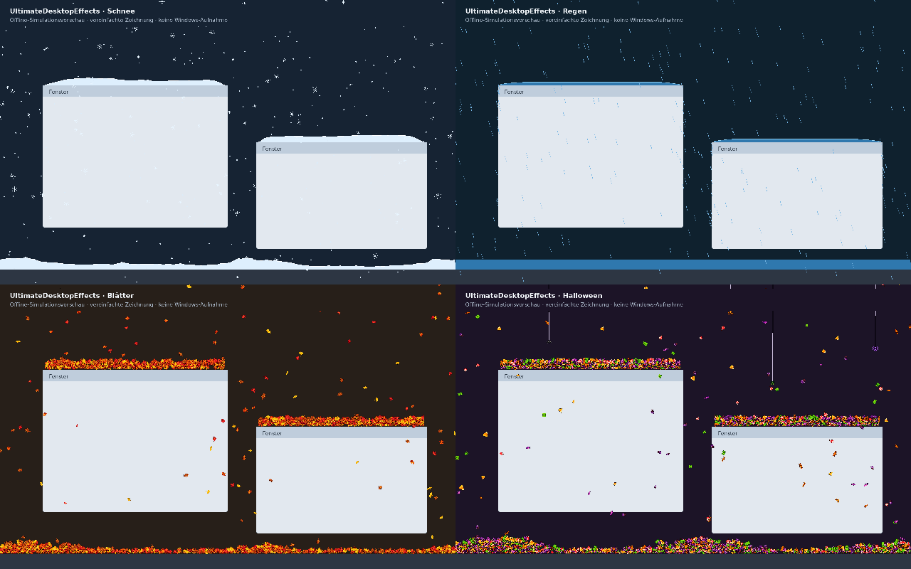

<div align="center">


# UltimateDesktopEffects

**Snow, rain, falling leaves and Halloween — four desktop effects in one native Windows app.**

[**Download for Windows**](https://github.com/povargg/UltimateDesktopEffects/releases/latest/download/UltimateDesktopEffects.exe) · [**Portable version**](https://github.com/povargg/UltimateDesktopEffects/releases/latest/download/UltimateDesktopEffects-Portable.exe) · [**All releases**](https://github.com/povargg/UltimateDesktopEffects/releases) · [**Deutsch**](README.de.md)

Windows 10 / 11 · x64 · C++17 · MIT license

Created by **[povargg](https://github.com/povargg)**, building on **[flipkips’ LayerSnow](https://github.com/flipkips/desktop-snow-overlay)**.

</div>

## Your desktop, with a change of season

Let snow build up on your windows, watch rain collect above the taskbar, scatter pixel leaves across the screen, or add Halloween sweets and spiders. Switch between all four effects from the settings window or tray menu, with no additional installation.

Each effect keeps its own settings. When you switch away, its scene pauses; return to it to continue the same falling particles and piles. Only the selected effect runs and draws.



*Preview generated from the actual simulation state with simplified offline drawing. This is not a Windows screenshot.*

## Four effects

| Effect | What it does |
| --- | --- |
| **Snow** | Soft flakes and four crystal shapes, wind and gusts, snowdrifts on windows and the taskbar, melting, sliding clumps and four snowfall presets. |
| **Rain** | Falling drops, splashes, collected water, animated waves and evaporation. Optional lightning, adjustable branches and brightness, and a separate screen-flash switch. |
| **Leaves** | Pink sakura petals, green spring/summer leaves, and yellow/orange/red autumn leaves. Four pixel variants per type, with swaying, tumbling and dense overlapping piles. |
| **Halloween** | Six pixel sweets and four spider types. Choose sweets, spiders or both. Spiders descend on threads, sometimes stop partway, pause, then have an equal chance to climb back up or drop. **Click a visible thread to cut it.** |

### Shared controls

- Show effects **over windows or behind them**.
- Collect particles on **window tops and the taskbar**.
- Adjust density, fall speed, wind, size, pile height, opacity and frame rate where supported by each effect.
- Brush piles away with the cursor, shake them off, or clear them.
- Pause and hide the overlay in fullscreen apps and games.
- Support multiple monitors and per-monitor display scaling.
- Optional Windows autostart and light/dark settings windows.
- **Five interface languages:** English, Deutsch, Русский, Українська and Română.

The leaves and Halloween sprites are native **16×16 pixel art**. Settled sprites retain their full visible face and overlap using compact collision footprints, producing a dense, slightly uneven layer.

## Download

**Current version: 1.0.1 · Windows x64**

| Download | Use |
| --- | --- |
| [**UltimateDesktopEffects.exe**](https://github.com/povargg/UltimateDesktopEffects/releases/latest/download/UltimateDesktopEffects.exe) | Install once, then launch from the Start menu. |
| [**UltimateDesktopEffects-Portable.exe**](https://github.com/povargg/UltimateDesktopEffects/releases/latest/download/UltimateDesktopEffects-Portable.exe) | Run immediately without installation. Keep `Portable` in the filename. |
| [**Source code ZIP**](https://github.com/povargg/UltimateDesktopEffects/releases/latest/download/UltimateDesktopEffects-Quellcode.zip) | C++ source, assets, build scripts, tests and documentation. |

Requires **Windows 10 version 1703 or newer, or Windows 11, 64-bit**, with Direct3D 11 support. The executable includes its C++ runtime; no .NET, Python or separate Visual C++ runtime package is needed to run it.

The release is **not digitally signed**.

## Quick start

1. Download the installer or portable executable above.
2. Open it. The installer uses your user account and does not require administrator rights.
3. Find the **UE chef-hat icon** in the notification area.
4. **Left-click** it for settings, or **right-click** for the quick menu.
5. Pick **Snow / Rain / Leaves / Halloween** at the top of the panel.

Additional rain options are in its weather settings. The leaves and Halloween modes have their own appearance panels. In Halloween, thread cutting can be disabled and its click tolerance adjusted.

## Settings and installation

Installation folder:

```text
%LOCALAPPDATA%\Programs\UltimateDesktopEffects
```

Settings, including portable mode:

```text
%APPDATA%\UltimateDesktopEffects\settings.ini
```

On first launch, existing effect settings can be imported from the previous `LayerSnow` / `SnowLayer`, `LayerRain`, `LayerLeaves` and `LayerHalloween` configuration folders. New profiles then live together in UltimateDesktopEffects. Interface language and autostart are shared; effect parameters remain independent.

Scenes and piles are kept in memory while switching effects. Settings and the last selected effect survive a restart; the visual scene starts fresh after reopening the app.

To uninstall, use Windows **Installed apps**, the Start menu shortcut, or `uninstall.exe` in the installation folder. The normal dialog lets you choose whether to remove settings.

| Command-line option | Action |
| --- | --- |
| `/portable` | Run without opening the installer. |
| `/uninstall` | Open the uninstaller. |
| `/uninstall /quiet` | Remove the installation and settings without a dialog. |
| `/autostart` | Start the application in its Windows autostart mode. |

## Native and local

UltimateDesktopEffects is a **native C++17 application**, using **Direct3D 11, Direct2D, DirectWrite and DirectComposition**. It runs one process, one overlay and one active simulation. Inactive effects retain bounded CPU state; their renderers and closed settings panels release their graphics resources when you switch.

Particle budgets, pile caches, window event updates and reduced frame rates for static scenes come from the individual effects. A CPU-only comparison of the combined dispatcher against direct simulation calls stayed within a few percent on the build host; see the [validation report](docs/VALIDIERUNG.md) for the measurements and their limits.

The app works locally, with **no accounts, telemetry or effect downloads at runtime**. GitHub links open in your browser only when clicked.

## Build from source

All required sprites and the Windows icon are included. Image generation is not required to build the app.

### MinGW-w64 — Windows or Linux

```sh
python3 build_mingw.py --cxx x86_64-w64-mingw32-g++-posix
```

The published executable was built with MinGW-w64 and a statically linked C++ runtime.

### Visual Studio — Windows

Install Visual Studio 2022 Build Tools with the **Desktop development with C++** workload and Windows SDK, then run:

```bat
build.bat
```

The Visual Studio build recipe is included as an alternative; the published binary was cross-compiled with MinGW-w64.

Build outputs are placed in `dist/`: the installer, portable executable and uninstaller share the same program bytes and select their mode from their filename or command-line options.

## Tests and validation

```sh
sh run-tests.sh
python3 tests/release_checks.py
```

Native simulation tests require a C++17 compiler with AddressSanitizer and UndefinedBehaviorSanitizer. Release checks require Python 3, Pillow and the built Windows executables.

- **1.0.0 baseline:** 185 native C++ simulation tests and 15 asset/integration/package checks passed.
- **1.0.1 update:** 15 release checks plus four targeted text/icon checks passed. The simulation logic was unchanged.
- Coverage includes effect switching, independent profiles, piles, window movement, mixed display scaling, lightning, spider state transitions and thread cutting.

**Validation limits:** the Windows UI, GPU composition, real mouse-hook delivery and installation were not exercised on a physical Windows desktop in the Linux build environment. Offline previews and simulation tests do not replace those runtime checks.

Detailed records: [validation](docs/VALIDIERUNG.md), [baseline test log](docs/testprotokoll.txt), [1.0.1 patch notes](docs/PATCH-1.0.1.md) and [patch test log](docs/patch-1.0.1-testprotokoll.txt).

## Project layout

```text
src/          Shared application, settings, renderer dispatcher and effect modules
res/          Windows resources, original pixel art and UE chef-hat icon
tests/       Native simulation and release verification tests
tools/       Asset preparation, offline preview and inspection tools
docs/        Architecture, provenance, validation and preview images
licenses/    Third-party runtime notices
```

## Credits and license

**[flipkips](https://github.com/flipkips)** created **[LayerSnow / desktop-snow-overlay](https://github.com/flipkips/desktop-snow-overlay)**, which provides the original snow effect and the Windows overlay, window detection, tray and installation foundation.

**[povargg](https://github.com/povargg)** developed the rain, pixel leaves and Halloween adaptations and combined them into UltimateDesktopEffects.

The original attribution and copyright notices are retained. The project is distributed under the **[MIT License](LICENSE)**; additional MinGW-w64 and GCC runtime notices are in [`licenses/`](licenses/). Pixel asset generation prompts and preparation sources are included with the assets.

If you enjoy the original snow effect, consider visiting and starring [flipkips’ repository](https://github.com/flipkips/desktop-snow-overlay).
