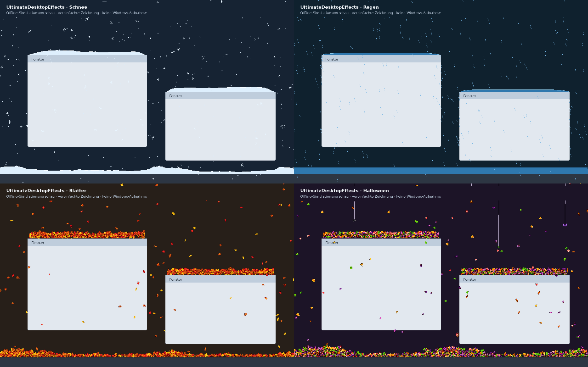

# Validierung – UltimateDesktopEffects 1.0.0

Prüfung am **1. November 2026**. Ergebnis: **200 automatisierte Prüfungen bestanden, 0 fehlgeschlagen**. Dazu kommen die visuelle Prüfung einer Offline-Simulation und ein Vergleich der reinen CPU-Berechnung.

## Tatsächlich ausgeführte C++-Tests

Die Tests kompilieren und verwenden dieselben Simulationsdateien wie die Windows-Anwendung. Die zum nativen Kompilieren nötigen Win32-Typen werden durch `tests/win_stub.h` ersetzt; die Berechnungslogik bleibt unverändert. Alle 185 Fälle liefen mit **AddressSanitizer und UndefinedBehaviorSanitizer**, ohne gemeldete Speicher- oder Undefined-Behavior-Fehler in diesen Testläufen.

| Testgruppe | Fälle | Geprüfte Bereiche |
| --- | ---: | --- |
| Schnee | 24 | Vier Kristallformen, weiche Flocken, Größe, Wind, Rotation, Fenster/Taskleiste, 15-FPS-Kollision, Schmelzen, versteckte Flocken, Verdeckung, Bewegung/Größenänderung von Fenstern, Abschütteln, Maus, gemischte DPI, Gelände und Voreinstellungen |
| Regen | 28 | Tropfen, Wasser, Randüberlauf, Ansammlungen, Verdunstung, Spritzer, Bewegung und Verdeckung, Blitze, Bildschirmbeleuchtung, Mehrmonitorbetrieb und Belastung |
| Blätter | 34 | Alle Blattarten/Varianten, Fallbewegung, Drehung, kompakte volle Motivfläche, Stapeln, Cursor, Abschütteln, Verfall, Fensterverhalten, DPI, Größen und Belastung |
| Halloween | 34 | Sechs Süßigkeiten, vier Spinnen, drei Inhaltsmodi, Abseilen/Teilabstieg, Hängepause, 1.000 50/50-Entscheidungen, Hochklettern, Fallenlassen, Fadenschnitt, Verdeckung, DPI und Begrenzungen |
| Gemeinsame Steuerung und Profile | 65 | Alle 16 Wechselkombinationen, Wiederaufnahme pausierter Szenen, unabhängige Parameter, alle Felder speichern/laden, Grenzen und fehlerhafte INI-Daten, gemeinsame Sprache, Vollbildpause, Deaktivierung, Löschen und spezielle Aktionen nur im richtigen Effekt |
| **Summe** | **185** | **Bestanden** |

Die gemeinsame Belastungsprüfung führt **1.200 schnelle Wechsel** mit hoher Dichte aus. Nach jedem Schritt darf nur der gewählte Effekt weiterlaufen. Die Updatezähler zeigten 300 Schritte je Effekt; inaktive Effekte erhielten keine Schritte. Weitere Fälle wechseln bei Dichte 0, entfernen Fenster und Monitore während der Pause und prüfen die Wiederherstellung des gespeicherten Effekts.

Ein Fadenschnitt kann nur die aktive Halloween-Szene verändern. Die Tests überprüfen ausdrücklich, dass ein pausierter Halloween-Zustand beim Regenbetrieb unverändert bleibt und der Schnitt nach der Rückkehr wieder funktioniert. Blitztests verhindern entsprechend Blitzaktionen im falschen Modus beziehungsweise während einer Vollbildpause.

## Grafik-, Quellcode- und Paketprüfungen

Diese 15 Fälle sind Datei-/Integrationsprüfungen und keine praktisch ausgeführten Windows-GUI-Tests.

| Nr. | Prüfung | Ergebnis |
| --- | --- | --- |
| 186 | Tatsächliche Windows-x64-PE32+-GUI, ASLR und NX | Bestanden |
| 187 | Ausschließlich Windows-System-DLLs importiert | Bestanden |
| 188 | Icon, DPI-/Berechtigungsmanifest, Version und beide Autoren eingebettet | Bestanden |
| 189 | Gleiche Bytes für Installation, portable Version und Deinstallation; passende Startlogik | Bestanden |
| 190 | Ein Programmeinstieg, eine Prozesssperre und ein gemeinsamer Tray-/Overlay-Host | Bestanden |
| 191 | Rendererfreigabe vor Neuinitialisierung; alte Panelobjekte werden ebenfalls freigegeben | Bestanden |
| 192 | Vierfachauswahl in allen Haupt-, Zusatz- und Schnellmenüfenstern mit Host verbunden | Bestanden |
| 193 | Alle 436 Textzeilen enthalten fünf Sprachspalten; Texte auch in der EXE vorhanden | Bestanden |
| 194 | Beide Autoren in Header, Installer und Lizenz; MIT erhalten | Bestanden |
| 195 | Vollständige 114 Profilfelder, atomare Speicherung und Erstimport der Einzelversionen | Bestanden |
| 196 | Alle 22 Blatt-/Halloween-PNGs: 16×16, harte Transparenz und begrenzte Palette | Bestanden |
| 197 | PNG-, C++- und tatsächlich eingebettete EXE-Pixel stimmen überein | Bestanden |
| 198 | Volle Stapelhöhe, kleine Kollisionsflächen und vollständige Verschiebung der UI-Rechtecke | Bestanden |
| 199 | Maus-Hook nur für aktives Halloween; getrennte Nachrichten-IDs und Weiterleitung | Bestanden |
| 200 | Alle neun ursprünglichen Simulations-Funktionskörper stimmen mit ihren Ausgangsversionen überein | Bestanden |

Der endgültige MinGW-w64-Build wurde **ohne Compilerwarnungen** erzeugt. Die tatsächlichen Importe lauten: `ADVAPI32`, `COMCTL32`, `d2d1`, `d3d11`, `dcomp`, `dwmapi`, `DWrite`, `dxgi`, `GDI32`, `KERNEL32`, `msvcrt`, `ole32`, `SHELL32`, `SHCORE` und `USER32`.

Vollständige Testausgaben: [testprotokoll.txt](testprotokoll.txt).

## CPU-Vergleich

Der Benchmark verwendet dieselben Effektklassen und dieselben Einstellungen mit festem Zufallsstartwert. Er vergleicht direkte Aufrufe der einzelnen Berechnung mit dem Aufruf über die gemeinsame Steuerung. Jeweils 3.600 Schritte ohne Echtzeit-Wartepausen, Median aus drei Läufen, nativer Linux-C++17-Build mit `-O2`.

| Effekt | Direkter Aufruf, ms | Gemeinsame Steuerung, ms | Verhältnis |
| --- | ---: | ---: | ---: |
| Schnee | 55,211 | 55,326 | 1,002 |
| Regen | 151,429 | 145,792 | 0,963 |
| Blätter | 21,927 | 21,818 | 0,995 |
| Halloween | 22,227 | 22,819 | 1,027 |

Die Abweichungen liegen in diesem Lauf bei wenigen Prozent. Vor allem entsteht kein vierfacher Berechnungsaufwand: Die anderen drei Effekte pausieren. Diese Werte messen ausschließlich die Simulationsberechnung in der Buildumgebung. Sie messen weder Windows-GPU-Leistung noch UI-Aufwand, Grafiktreiber oder die CPU-Auslastung auf einem bestimmten Nutzer-PC.

Rohdaten: [benchmark.txt](benchmark.txt). Reproduktion: `sh tools/inspect.sh`.

## Visuelle Offline-Prüfung

`tests/preview.cpp` führt alle vier Effekte jeweils 150 simulierte Sekunden über den gemeinsamen Controller aus. Exportiert werden die tatsächlichen Positionen, Oberflächenhöhen, Stapelobjekte und Fäden. `tools/preview.py` erstellt daraus eine vereinfachte technische Zeichnung. Geprüft wurden Ansammlungen auf zwei Fenstern und der Taskleiste, Fallbewegungen, volle Blatt-/Süßigkeitenflächen und Spinnen an Fäden.

Schnee und Regen verwenden ihre kontinuierlichen Höhenfelder. Im aufgenommenen Blattzustand waren 1.883 Motive abgelegt, im Halloween-Zustand 2.654 Motive sowie vier befestigte Spinnen. Die Vorschau dient der Kontrolle der Simulation; Antialiasing, Transparenz, Wellen, Licht und die übrige GPU-Zeichnung sind darin vereinfacht.

## Praktische Grenzen

Die Windows-EXE wurde in dieser Linux-Umgebung **nicht auf einem echten Windows-Desktop gestartet**. Daher wurden die tatsächliche GPU-Komposition, Bildschirmdarstellung, Maus-Hook-Zustellung, Tray-Integration, Installation/Deinstallation und DPI-Wechsel nicht praktisch unter Windows bestätigt. Die dafür notwendige lokale Display-Infrastruktur ist in der Ausführungsumgebung gesperrt. Erfolgreiche Kompilierung, native Simulationstests und statische Integrationsprüfungen ersetzen diese Prüfung nicht.

Das Programm ist nicht digital signiert. Es wurde kein allgemeines Fehlerfreiheitsversprechen und keine vollständige Abdeckung sämtlicher Windows-/Treiberkonfigurationen abgeleitet.
